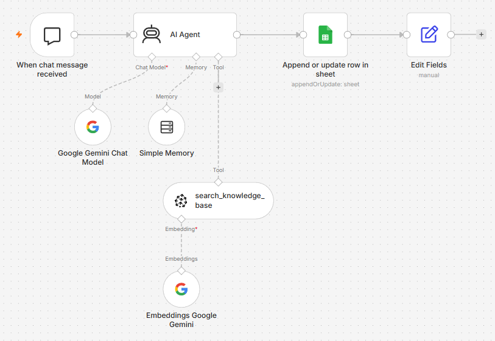

# UPI Fraud Helpdesk Chatbot (PayGuard Assistant)

A RAG chatbot that answers UPI fraud, refund and complaint questions from official RBI and NPCI documents. It names the source in its answers and says so when something is not in its documents.

Built with **n8n**, **Google Gemini**, **Pinecone**, **Google Drive** and **Google Sheets**. It is a no-code project: the whole agent is two n8n workflows.

**Demo video:** 



---

## The problem

After a UPI fraud, people do not know three things: what they must do first, how much money they can lose, and where to complain. The answers exist in RBI and NPCI documents, but those documents are long and hard to read. This chatbot reads them and answers in plain English.

## What it does

- Answers questions from the RBI circular and the NPCI dispute redressal mechanism.
- Names the source in its answers, for example *(RBI circular, Para 9)*.
- Remembers the conversation, so follow-ups like "and if it takes 6 days?" work.
- Says "This is not in my documents" when it does not know, instead of guessing.
- Labels anything from outside the documents as *General guidance (not from my documents)*.
- Never promises a refund and never asks for a PIN or OTP.
- Refuses off-topic questions and harmful requests.
- Logs every chat to a Google Sheet.

### Example

**Question:** Where do I first raise a UPI complaint, and what if it isn't fixed?

**Answer (from the NPCI document):** Raise the complaint first on the UPI app you used. If it is not resolved, escalate in this order: the PSP bank, then your own bank, then NPCI. After that, you can approach the Banking Ombudsman and/or the Ombudsman for Digital Complaints.

## How it works

The project has two n8n workflows.

**1. Push Data to Vector Database** (`workflows/1-push-data-to-vector-database.json`)

```
Google Drive Trigger -> Download file -> Pinecone Vector Store
                                          |- Embeddings Google Gemini
                                          |- Default Data Loader
```

A PDF in a Google Drive folder is downloaded, split into chunks with n8n's default document loader, turned into embeddings with Gemini, and stored in Pinecone. Run this workflow once for each new document.

**2. UPI Chatbot** (`workflows/2-upi-chatbot.json`)

```
When chat message received -> AI Agent -> Append row in Google Sheet -> Edit Fields
                               |- Google Gemini Chat Model
                               |- Simple Memory
                               |- Tool: search_knowledge_base (Pinecone Vector Store)
                                     |- Embeddings Google Gemini
```

The AI Agent searches Pinecone first, then answers from what it finds. The system prompt is in [docs/system-prompt.txt](docs/system-prompt.txt).

## Documents used

| Document | Source |
|---|---|
| RBI circular RBI/2017-18/15, 6 July 2017: *Customer Protection - Limiting Liability of Customers in Unauthorised Electronic Banking Transactions* | [RBI website](https://www.rbi.org.in/commonman/english/scripts/Notification.aspx?Id=2336) |
| NPCI *Dispute Redressal Mechanism* (UPI, 1 page) | [NPCI website](https://www.npci.org.in), UPI section |


## Tech stack

| Part | Tool |
|---|---|
| Workflow builder | n8n |
| Chat model and embeddings | Google Gemini API (free tier) |
| Vector database | Pinecone |
| Document storage | Google Drive |
| Chat log | Google Sheets |

## How to run it

1. Install n8n (`npx n8n`) or use n8n Cloud. This project was built on an n8n Cloud trial and exported, so it also runs on a free self-hosted n8n.
2. Import both files from the `workflows/` folder (menu, then **Import from file**).
3. Add your own credentials: Google Drive, Google Sheets, Gemini API key and Pinecone API key. Credentials are not included in the exported files.
4. Create a Pinecone index. Its dimension must match your Gemini embedding model, and both workflows must use the same index and namespace.
5. Put the two documents in a Google Drive folder, then point the Drive Trigger in workflow 1 at that folder. Pick your own Google Sheet in the chat log node.
6. Run workflow 1 once for each document. Do not run it twice for the same file, because that stores the text twice.
7. Open workflow 2 and click **Open chat**.

### Problems found and fixed

- **The bot added facts that are not in the documents.** My first prompt told it to give the 1930 helpline and the cyber crime portal on its own. I rewrote the system prompt so it answers from the documents first and labels anything else as general guidance.
- **The NPCI document was missing from the vector store.** A test question about where to complain was answered from the RBI circular only. I loaded the NPCI document into Pinecone and the answer then matched the NPCI source.
- **Free-tier limits.** Gemini's free tier has a small daily request limit per model, so I spread the testing over several days.

## Limitations

- It uses two documents, so it cannot answer questions about scam types, prevention tips or UPI basics.
- The NPCI document is one page, so complaint answers are short.
- The RBI circular is from 2017. Rules may have changed, so users should confirm with their bank.
- The circular applies to scheduled commercial banks, small finance banks and payments banks, not to every institution.
- Answers vary a little between runs, and a citation can point to the wrong paragraph number (seen once in testing).
- The Gemini free tier has daily request limits, so heavy use can hit a rate-limit error.
- Advice such as calling 1930 is not in the documents. The bot labels it as general guidance.
- It gives information, not legal or financial advice. It cannot access bank accounts, trace payments or file complaints.

## Future scope

- Telegram or WhatsApp version, so people can use it on their phones.
- Hindi and Marathi support.
- More official documents: RBI awareness booklet, Ombudsman scheme, cyber crime reporting pages.
- A step-by-step "report my fraud" flow.
- A feedback button, so users can mark wrong answers.

## Repo contents

```
README.md
workflows/   the two n8n workflow files
docs/        system prompt and full test results
screenshots/ workflow and chat screenshots
```

## Disclaimer

This is a student project. It is not affiliated with RBI, NPCI or any bank. Do not treat its answers as legal or financial advice.


